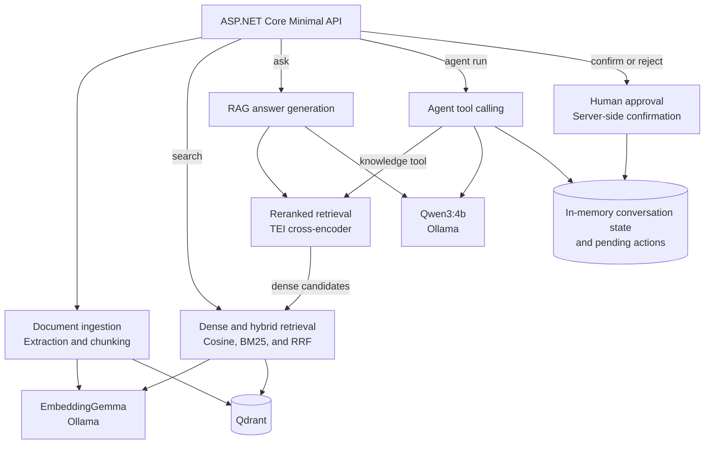

# KnowledgeOps — Local RAG Knowledge Base & Tool-Using AI Agent

KnowledgeOps is a .NET 10 backend for indexing documents, comparing retrieval strategies, and answering questions with source excerpts. It runs EmbeddingGemma and Qwen3 locally through Ollama, stores document chunks in Qdrant, and uses Hugging Face Text Embeddings Inference (TEI) for cross-encoder reranking. A support agent can look up demo orders and prepare tickets for explicit human approval.

## Architecture



## Key Features

### RAG & Retrieval

- Index JSON text and TXT, Markdown, or text-based PDF uploads. Overlapping chunks retain source metadata and offsets.
- Update or delete indexed documents by ID. Compare dense cosine search, hybrid search that fuses dense and BM25 rankings with RRF, and cross-encoder reranking.
- Generate cited answers with a bounded context. The RAG route uses reranking by default and supports a dense mode through `Rag:RetrievalMode`.

### AI Agents

- Qwen3 calls allowlisted tools to search the knowledge base, look up demo order status, and prepare a support ticket.
- Follow-up requests reuse bounded conversation history, including tool results. The server creates a ticket only after explicit approval through a separate endpoint.

### Reliability & Evaluation

- Request cancellation, bounded model and tool calls, and one automatic retry for transient agent search failures.
- xUnit tests cover chunking, retrieval, API behavior, and the approval flow. API tests substitute model services, and Qdrant integration tests use Testcontainers.
- The evaluation runner compares document-level rankings in temporary Qdrant collections and writes per-query JSON reports.

## Tech Stack

| Area | Technology |
| --- | --- |
| Backend | C#, .NET 10, ASP.NET Core Minimal APIs |
| Local inference | Ollama, EmbeddingGemma, Qwen3:4b |
| Model integration | Microsoft.Extensions.AI, OllamaSharp |
| Retrieval | Qdrant 1.20, cosine similarity, BM25, reciprocal rank fusion |
| Reranking | Hugging Face TEI (CPU), `Alibaba-NLP/gte-multilingual-reranker-base` |
| Ingestion and testing | PdfPig, xUnit, ASP.NET Core TestHost, Testcontainers |

## Evaluation

Results from local runs on the [standard](evaluation/dataset.json) and [hard](evaluation/dataset-hard.json) Russian-language datasets. Hybrid uses equal-weight RRF, and reranking reorders up to 20 dense candidates.

| Mode | Standard Hit@1 | Standard MRR@5 | Hard Hit@1 | Hard MRR@5 |
| --- | ---: | ---: | ---: | ---: |
| **Dense** | **93.75%** | **0.9688** | **100%** | **1.0000** |
| Hybrid | 68.75% | 0.8438 | 93.75% | 0.9583 |
| Dense + Reranker | 75.00% | 0.8542 | 87.50% | 0.9375 |

Dense led on both datasets. All three modes reached 100% Hit@3 and Hit@5. Each dataset has 20 questions, and only the 16 answerable questions contribute to the ranking metrics. These small runs measure retrieval, so they do not establish answer quality or generalize to larger corpora.

Run both comparisons from the repository root. The generated reports are written to the gitignored `evaluation/results/` directory.

```bash
dotnet run --project tools/KnowledgeOps.Evaluation
dotnet run --project tools/KnowledgeOps.Evaluation -- --reranking
```

## Quick Start

Requires the .NET 10 SDK, Docker with Compose, and Ollama running locally.

```bash
docker compose up -d qdrant
docker compose up -d tei
ollama list
ollama pull embeddinggemma
ollama pull qwen3:4b
dotnet run --project src/KnowledgeOps.Api --launch-profile http
```

The API listens on `http://localhost:5159`. TEI may need time to download and warm up the model on its first start. Wait for `http://localhost:8081/health` to return HTTP 200 before using reranked retrieval.

## API Examples

Index the example delivery document before trying the RAG request.

```http
POST http://localhost:5159/api/ask
Content-Type: application/json

{"query":"How long does courier delivery take?","topK":3}
```

```http
POST http://localhost:5159/api/agent/run
Content-Type: application/json

{"conversationId":null,"message":"Where is my order ORD-123?"}
```

The RAG response includes source excerpts. The agent returns a `conversationId` for follow-up requests and a trace of executed tools. See the [HTTP request collection](src/KnowledgeOps.Api/KnowledgeOps.Api.http) for uploads, search, and ticket approval.

## Security & Limitations

- Orders are mock data. Conversations expire after 30 minutes of inactivity. Conversations and tickets live in a single API process and are lost on restart.
- Pending actions expire after five minutes and are scoped to a conversation. The confirmation endpoint validates both IDs and returns the same ticket on repeated approval.
- The API has no authentication. Anyone with both IDs can confirm a pending action. Run this demo locally.
- Retrieved text is untrusted input. The tool allowlist and server-side approval constrain actions, while generated answers can still be wrong.
